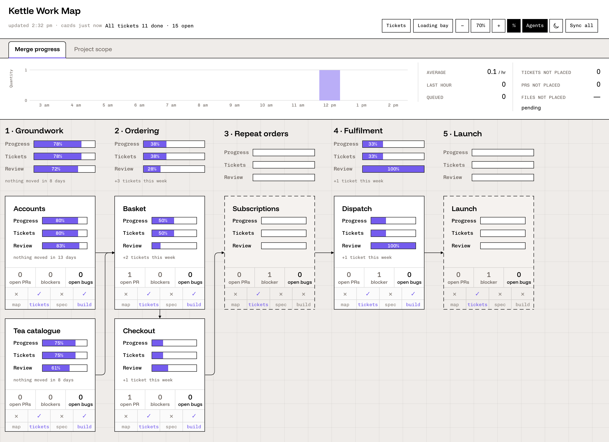
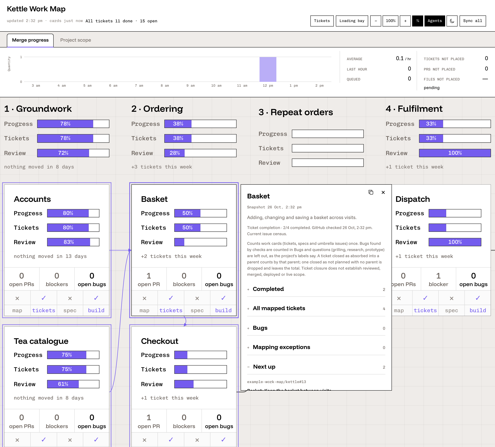
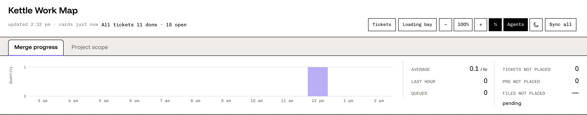

# Work map

Work map is a local, read-only window onto a software project's build. You describe the project once in its roadmap repository: the stages and sections of the build as a diagram, the repositories to read, and how tickets find their section. The map then reads issues and pull requests from GitHub under your own login, places each one on a section, and draws a card per section with how much of it is done, how much of its changed code was reviewed, and its open pull requests and blockers. A header shows the whole project's progress and the last twelve hours of merges.

<picture>
  <source media="(prefers-color-scheme: dark)" srcset="docs/screenshots/map-dark.png">
  
</picture>

It runs on your Mac, serves the page on `127.0.0.1` only and never writes to GitHub.

## Requirements

- macOS. The installer schedules the map with launchd; the map itself is plain Node.
- Node 24.
- pnpm, the version in `package.json`'s `packageManager`. `corepack enable` provides it.
- For your own project, the [GitHub CLI](https://cli.github.com/) (`gh`), logged in with `gh auth login`. The example needs no login.

## Install

```sh
git clone https://github.com/LaunchAstro/work-map.git
cd work-map
pnpm install --frozen-lockfile
pnpm build
```

## Quick start: the example

`examples/demo/` is a made-up project, Kettle, an online tea shop. It ships with a recorded GitHub read, so it runs with no login and no network:

```sh
sh examples/demo/run.sh
```

Open `http://127.0.0.1:4317`. Set `WORK_MAP_PORT` for another port. `Ctrl-C` stops it. [`examples/demo/README.md`](examples/demo/README.md) explains each file.

Scroll or drag to pan, pinch or ⌘ + scroll to zoom, and press `0` to go back to 100%. Hover a card to see its connections; click it, or press Enter, for its details:

<picture>
  <source media="(prefers-color-scheme: dark)" srcset="docs/screenshots/card-dark.png">
  
</picture>

The header counts the project's tickets, shows merges hour by hour in the map's time zone, and lists work no section places:

<picture>
  <source media="(prefers-color-scheme: dark)" srcset="docs/screenshots/header-dark.png">
  
</picture>

## Use it on your own project

1. **Write the config.** Copy `examples/demo/roadmap/` into a folder of your project's roadmap repository, for example `work-map/`. The paths under `project.json`'s `files` are relative to the repository's root, so add the folder to each (`work-map/flow.json`). Then change `project.json`'s repositories, labels and sections, and `flow.json`'s diagram. [`docs/config.md`](docs/config.md) describes every setting.
2. **Log in to GitHub.** `gh auth login`, with read access to every repository the config names.
3. **Install the map.** From the tool clone:

   ```sh
   WORK_MAP_PROJECT=/path/to/roadmap/work-map/project.json \
   WORK_MAP_ROADMAP=/path/to/roadmap \
   sh ops/install.sh
   ```

   This builds the page and adds three launchd jobs for your user: the server (kept running), a GitHub read every five minutes, and a local read every 45 seconds. The first GitHub read runs at once.

4. **Open it.** `sh ops/open-window.sh`, or open `http://127.0.0.1:4317`. Press **Sync** to read every card from GitHub.

The installer's settings come from the environment or from a file of `KEY=value` lines (`--config FILE`):

| Setting                | Default                                | What it is                                                      |
| ---------------------- | -------------------------------------- | --------------------------------------------------------------- |
| `WORK_MAP_PROJECT`     | required                               | the project's `project.json`                                    |
| `WORK_MAP_ROADMAP`     | required                               | a clone of the roadmap repository; the five-minute job pulls it |
| `WORK_MAP_NODE`        | `node` on `PATH`                       | a Node 24 executable                                            |
| `WORK_MAP_PORT`        | `4317`                                 | the server's port on `127.0.0.1`                                |
| `WORK_MAP_DATA`        | `~/.local/share/work-map/<project id>` | where the map keeps its reads                                   |
| `WORK_MAP_LABEL`       | `local.work-map.<project id>`          | the launchd jobs' label prefix                                  |
| `WORK_MAP_SELF_UPDATE` | `0`                                    | `1` pulls this tool's checkout before each five-minute read     |
| `WORK_MAP_ROUND_ROOT`  | none                                   | a folder of `round-*/events.log` agent run logs (must exist)    |

Run the installer again to change a setting. `sh ops/install.sh --remove`, with the same `WORK_MAP_PROJECT` (or `WORK_MAP_LABEL`), takes out this map's jobs. `--no-launchd` writes the job files and prints the `launchctl` commands instead of running them.

For a second project, install again with another `WORK_MAP_PROJECT` and `WORK_MAP_PORT`. Each map keeps its own data folder and jobs. To switch between maps in one window, put a `maps.json` in each data folder (see [`docs/config.md`](docs/config.md)).

## What it reads from GitHub

The map reads GitHub's GraphQL API through `gh`, under your login. GitHub gives each login 5,000 points an hour, shared with everything else that uses that login, so the map reads as little as it can:

- **Every five minutes** it reads only the merge panel (pull requests merged since the last read and the merge queue): about one point.
- **Sync** reads the merge panel, the cards whose issues or pull requests changed since the last read, and map gaps. A card read starts with one search for what changed, so a quiet project costs a few points and a busy one more.
- **A card never read** is read once by the next five-minute read.

Every read stops, keeping the last good figures, when fewer than 1,000 points are left in the hour; the five-minute read stops below 1,500. Between reads, cards show their last values and the header says how old they are. Each read's cost is logged in `runs.jsonl` in the data folder.

## Privacy and safety

- **Local only.** The server listens only on `127.0.0.1`, answers only requests addressed to that exact host and port, and refuses requests from other sites' pages.
- **Read-only.** The map sends GitHub queries and nothing else. It never comments, labels, merges or edits.
- **No credentials of its own.** `gh` keeps your login; the map never stores or logs a token.
- **Your data stays on your Mac.** Reads are saved in the data folder, outside the tool's checkout. Nothing is sent anywhere else, and no paid API or model is called.

`SECURITY.md` says how to report a problem privately.

## Docs

- [`docs/config.md`](docs/config.md): every setting in `project.json` and the files it names.
- [`docs/ticket-lines.md`](docs/ticket-lines.md): the `Section:` and `Ticket:` lines that place work on a section.
- [`CONTRACT.md`](CONTRACT.md): the two files the page reads, `snapshot.json` and `agents.json`.
- [`CONTRIBUTING.md`](CONTRIBUTING.md) and [`AGENTS.md`](AGENTS.md): working on the code.

## Checks

```sh
pnpm typecheck
pnpm lint
pnpm format:check
pnpm test
pnpm build
```

The tests need Playwright's Chromium and WebKit (`pnpm exec playwright install chromium webkit`), and no network or GitHub login. `CONTRIBUTING.md` covers setup and what a pull request needs.

## Licence

The work map is free software under the GNU Affero General Public License, version 3 only (`AGPL-3.0-only`), in `LICENSE`. You may use, change and share it. If you share it, changed or not, or let others use a changed version over a network, you must offer them its source under the same licence. The bundled fonts keep their own SIL Open Font License 1.1; `THIRD-PARTY-NOTICES.md` lists them.

---

Made by [Agency Astro](https://agencyastro.com)
